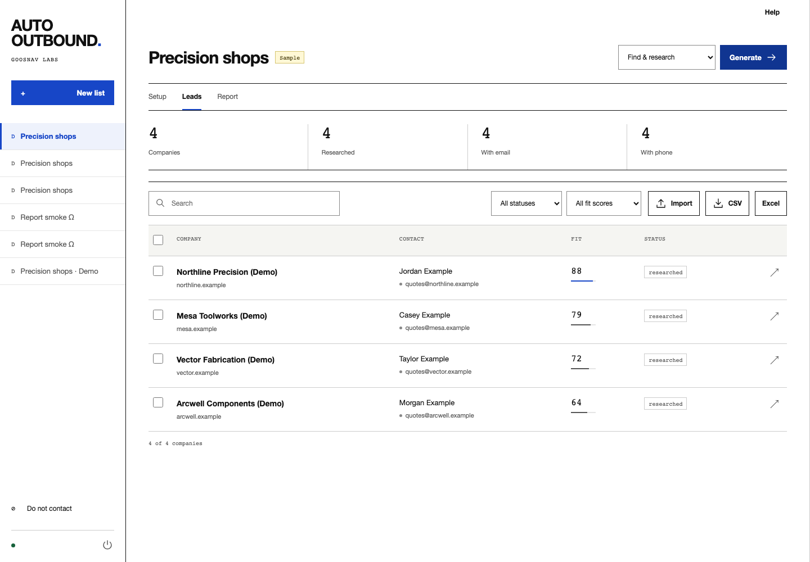

# Auto Outbound

**Generate researched lead lists. Download CSV or Excel reports.**

A local lead-list and report generator from Goosnav Labs. Bring an installed, authenticated **Codex** or **Claude Code** CLI. Use the browser workspace or the same workflow from the command line. Your campaigns and offers stay in a local SQLite database; the selected AI provider receives the task inputs needed for research and drafting.

Set an audience, generate the research, and download the result. Email drafts are optional. The app does not send messages.



*Fictional demo data. [Research report](docs/screenshots/report.png) · [Evidence review](docs/screenshots/review.png) · [Mobile workspace](docs/screenshots/mobile.png).*

## Start

### Desktop ZIP — click to open

Extract `Auto-Outbound-Desktop-preview.zip`. Keep the command files beside `app/`.

| Computer | Open |
|---|---|
| macOS | Double-click `Open Auto Outbound.command` |
| Windows | Double-click `Open Auto Outbound.cmd` |
| PowerShell | Run `Open Auto Outbound.ps1` |
| Linux | Run `sh "Open Auto Outbound.sh"` |

The launcher opens your browser, downloads pinned Python and locked dependencies on first launch, and opens the workspace. Customers do not need Python, Node, Go, or package-manager tools. Later launches reuse the runtime and reopen an existing healthy instance. **Quit app** stops the server; closing a tab leaves it available.

The script edition uses the existing Go supervisor on all six build targets. It is the command-file delivery format requested for this product. It does not replace native `.app`/`.exe`/AppImage acceptance. macOS Apple Silicon passed the launch and browser workflow here. Windows, Linux, and Intel Mac desktop behavior remain unverified. The ZIP is an unsigned preview; **M1a remains ACTIVE**.

For live research, install and sign in to [Codex](https://developers.openai.com/codex/cli/) or [Claude Code](https://code.claude.com/docs/en/overview). Research uses your selected provider account. Provider subscriptions and usage limits remain separate. **Open sample** uses fictional data and needs no agent account.

[Installation, data locations, recovery, and release builds](docs/INSTALL.md).

### Source checkout

The generated runtime tools and supervisor binaries are excluded from Git. Developers can run the same GUI with `uv`:

```sh
uv run --project app --locked --no-dev python app/run.py gui
```

Build the complete command-file edition before using the root launchers from a fresh checkout:

```sh
# Build host only: pinned Go from scripts/launcher/tool-versions.json.
python3 scripts/build_release.py --script-launchers --package \
  --output dist/Auto-Outbound-Desktop-preview.zip
```

The build bundles pinned `uv` for six targets. Run `--reuse-images` with the same options for application-only updates. The original native image builder remains available for full M1a verification.

If a launcher cannot find your agent CLI, set `AUTO_OUTBOUND_CODEX_BIN` or `AUTO_OUTBOUND_CLAUDE_BIN` to its executable path. Windows `.cmd`/`.bat` provider wrappers are unsupported; use the provider's underlying `.exe`.

## Workflow

1. **Audience.** Set business type, geography, size, decision-maker roles, required attributes, exclusions, and useful buying signals. Set the target count and minimum fit.
2. **Optional context.** For a lead list, leave the offer and sender details blank if you do not need them. To prepare email drafts, describe the outcome you can deliver and your actual proof/constraints. Add up to four TXT, Markdown, PDF, DOCX, or CSV documents. Scanned PDFs need OCR first. Long offers/documents are reduced to a cached brief using the complete accepted text.
3. **Find.** Independent discovery batches search public sources. Domain normalization merges duplicate companies. Missing contacts remain missing. Discovery stops at the target, the configured batch limit, or repeated low yield.
4. **Research.** Each company gets a separate agent call and a saved dossier: capabilities, appropriate business contacts, evidence excerpts, fit reasoning, unknowns, and an explicitly tentative pain hypothesis.
5. **Check.** The app checks email syntax and DNS routing, and attempts bounded independent reads of cited pages. It records inaccessible sources and unmatched evidence. It never calls MX success “mailbox verified.”
6. **Optional email drafts.** A separate company-specific call writes all three emails from its saved dossier. If the audience, offer materials, provider/model, or research-page limit changes, run Research again before Draft. No repeated browsing per follow-up. Subjects are 1–5 words; first emails are capped at 90 words, follow-ups at 65. Copy checks flag long sentences, placeholders, unsupported source URLs, duplicate follow-ups, hype, and simulated reply prefixes.
7. **Report.** Download CSV or Excel from the lead list or Report tab. Excel includes Summary, Leads, and Read me sheets. Full research needs no copy approval. For an email handoff, review the optional drafts and record mailbox verification first. Import sender/CRM outcomes to prevent repeat contact and track replies, meetings, and wins.

The writing approach is **plain English inspired by Simplified Technical English**. It does not claim formal ASD-STE100 compliance. This app does not implement the standard's complete controlled vocabulary and rule set.

## What a lead contains

| Group | Fields |
|---|---|
| Business | Name, official website/domain, location, industry, size, description |
| Contact | Name, role, published work email, business phone, LinkedIn/social links |
| Evidence | Separate contact source URLs, supporting excerpts, research dates, source-check gaps |
| Fit | Score with reasons, risks, observed workflow, tentative pain hypothesis |
| Sequence | Three subjects/bodies, distinct angles, supporting sources, proposed days 0/4/9 |
| Review | Approval, copy checks, notes, suppression, export blockers |
| Verification | Published/MX/verified/invalid/catch-all/risky/unknown, verifier and timestamp |
| Outcomes | Sent, replied, positive, booked, won, lost, bounced, unsubscribed, not interested |

One lead row represents one company domain and one primary contact. Sending exports deduplicate shared mailboxes and keep the highest-fit approved record; verifier and outcome imports update every matching company. This version does not model a multi-contact account hierarchy. It does not invent headcount, budget authority, pain, or contact details to fill columns.

## Controls and persistence

- Explicit maximum agent calls, elapsed running time, per-call timeout, and concurrency (1–4; default 2).
- Claude turn limits and dollar allowances. **Claude's reported cost and budget estimate are not a guaranteed billing ceiling.** Unknown cost after failed/cancelled calls retains a conservative allowance; the UI separates this from reported spend. Codex does not expose an equivalent native dollar cap, so it is bounded by calls, time, and output size instead.
- At most one retry for specified malformed/transient failures, within the same call budget.
- Successful discovery batches, research, and drafts are saved independently. Pause/resume and crash recovery reuse successful work. Input changes invalidate the relevant cached result and approval.
- Actual counts and stage progress. Unknown usage displays as unavailable, not zero.
- Global email/domain suppression survives campaigns and takes precedence over approval. Sender outcomes block repeated export; negative outcomes create suppression.
- SQLite WAL transactions, bounded file imports, spreadsheet formula neutralization, per-launch session token, same-origin checks, public-only source fetching, and isolated agent working directories.
- No API credentials stored by this app, no analytics, no hosted account, no background outreach.

Data defaults to `AutoOutbound` under your operating system's application-data directory. `--data-dir` or `AUTO_OUTBOUND_DATA` selects another workspace. See [data and recovery](docs/INSTALL.md#data-and-recovery). Avoid committing databases, offers, contact lists, or exports.

## CLI

Use `uv run --project app --no-dev python app/run.py` as the command prefix below. All operational commands support `--json`; the GUI calls the same service layer.

```sh
# Define a campaign. This does not start an agent.
uv run --project app --no-dev python app/run.py campaign create \
  --name "Aerospace machine shops" \
  --icp "Independent machine shops making aerospace components" \
  --location "Southern California" \
  --role Owner --role Operations \
  --must-have "Drawing-based quote requests" \
  --offer-file examples/offer.md \
  --provider codex --target 25 --max-calls 80 --json

# Use the returned campaign ID.
uv run --project app --no-dev python app/run.py run CAMPAIGN_ID --stage report
uv run --project app --no-dev python app/run.py leads CAMPAIGN_ID --min-fit 70
uv run --project app --no-dev python app/run.py export CAMPAIGN_ID \
  --format xlsx --scope all --output exports/research.xlsx
```

| Command | Purpose |
|---|---|
| `campaign list / show / configure` | Inspect or update campaign settings with JSON |
| `offer ID --text ... --file ...` | Update offer text and documents |
| `import-leads ID FILE` | Import CSV/XLSX; company and website required |
| `run ID --stage report/discover/research/verify/draft/pipeline` | Run only the work needed |
| `pause JOB_ID`, `resume JOB_ID`, `cancel JOB_ID` | Control saved jobs; Ctrl-C pauses |
| `jobs list / show` | Progress, events, usage, failures |
| `leads ID --json` | Full records and export blockers |
| `edit-lead ID --file patch.json` | Edit contact/copy or verification evidence |
| `review LEAD_ID --status approved` | Record human review |
| `verify-import ID FILE --source "Verifier"` | Import dated external mailbox checks |
| `outcomes-import ID FILE` | Import sending/CRM results |
| `suppress add --email ...` or `--domain ...` | Global exclusion |
| `suppress import FILE` | Load existing customers, opt-outs, and bad addresses |
| `export ID --scope all/approved/callable --output FILE` | CSV/XLSX handoff |
| `backup --output FILE` | Consistent SQLite backup |
| `demo --run --json` | Offline, end-to-end fictional example |

Exit codes: `0` completed; `2` invalid input/setup; `3` failed job; `4` exhausted job budget; `5` paused/cancelled. JSON errors have `error.code` and `error.message`. CLI workers run in the foreground; use your process supervisor for unattended execution.

## Sending handoff

**Full research** includes all rows and their status. It is not a sending list. **Ready to send** (`--scope approved`) requires human approval, recent mailbox verification (30 days), complete sender identity/address, adequate fit, usable copy, a contact source, no suppression, and no prior imported activity. A sourced phone list uses `--scope callable`.

Use [the CSV templates](examples/) for verifier results, outcomes, and suppression. Keep `footer` attached to every email in your sender. Apply the exported subjects/bodies as per-lead variables. Follow-up delays are suggestions measured from the first send, not a sending schedule managed here.

Your sending platform must authenticate the sending domain, control volume, manage unsubscribe headers, and stop sequences on replies, bounces, or opt-outs. Configure SPF/DKIM/DMARC and monitor actual delivery. [Gmail sender guidance](https://support.google.com/mail/answer/81126?hl=en) and [FTC commercial-email guidance](https://www.ftc.gov/business-guidance/resources/can-spam-act-compliance-guide-business) explain the relevant requirements; the app does not certify a campaign's compliance.

## Tests and architecture

```sh
uv sync --project app --locked
uv run --project app python -m pytest -c app/pyproject.toml tests
uv run --project app ruff check --config app/pyproject.toml app/src tests scripts/build_release.py scripts/launcher/package_universal.py
python3 -m unittest discover -s scripts/launcher -p 'test_*.py'
```

`models` and `quality` define the records and invariants; `service` owns workflows; `storage` persists them; `pipeline` runs bounded jobs; `providers` isolates the CLI processes; `api` and `cli` are adapters. Static HTML/CSS/JavaScript ships without a frontend build or runtime CDN. [HTTP contract](docs/API.md).

Tests exercise actual SQLite and API workflows, CLI parity, subprocess contracts, resumability, budgets, suppression, verifier imports, source-fetch restrictions, and spreadsheet exports. Browser smoke tests exercised the real app with fictional data. Live authenticated model output quality has **not** been benchmarked in this build; provider tests use executable fixtures. Review an initial small live cohort before increasing the target.

The repeatable browser check requires an isolated running app:

```sh
uv run --project app python tests/browser_smoke.py --url http://127.0.0.1:PORT
```

It creates fictional lists and checks required inputs, an offer-free report run, filters, evidence, actual CSV/XLSX downloads, and layouts down to 320px. Use a test data directory rather than your working database.
